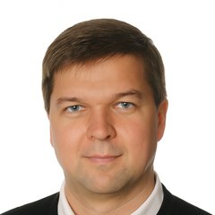
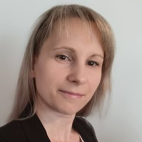

::::: {.emi-hero .column-screen}
:::: {.emi-wrap .emi-hero-grid}
::: {.emi-hero-szoveg}
[Debreceni Egyetem · Pszichológiai Intézet]{.emi-eyebrow}

<h1 class="emi-hero-cim">Ember–MI Kapcsolatok Kutatócsoport</h1>

[Azt vizsgáljuk, hogyan alakítja a mesterséges intelligencia az emberi gondolkodást, döntéshozatalt, munkavégzést és társas kapcsolatokat.]{.emi-hero-lead}

[A kutatócsoportról](kutatocsoportrol.qmd){.emi-gomb .emi-gomb-elsodleges} [Legfrissebb hírek](#friss){.emi-gomb .emi-gomb-masodlagos}
:::

::: {#hero-esemeny .emi-hero-panel}
:::
::::
:::::

:::: {.emi-wrap .emi-szakasz .column-screen}
<h2 class="emi-cimsor">Kutatási területeink</h2>

[Interdiszciplináris megközelítésben kapcsoljuk össze a technológiai fejlődést emberközpontú, etikai és társadalmi szempontokkal. Célunk a mesterséges intelligencia felelős, átlátható és társadalmilag hasznos alkalmazásának elősegítése.]{.emi-bevezeto}

::: {.kartya-lista .emi-teruletek}
- Ember–MI együttműködés és interakció
- Az MI társadalmi és kulturális hatásai
- Etikus és felelős MI-fejlesztés
- Bizalom, átláthatóság és elszámoltathatóság
- Az MI szerepe az oktatásban és a munka világában
- Emberközpontú technológiai megoldások
:::
::::

::::: {#friss .emi-wrap .emi-ketoszlop .column-screen}
:::: {.emi-oszlop}
::: {.emi-blokkfej}
<h2 class="emi-blokkcim">Hírek</h2>

[Összes hír →](lp_mi_hirek_napi.qmd)
:::

::: {#friss-hirek}
:::
::::

:::: {.emi-oszlop}
::: {.emi-blokkfej}
<h2 class="emi-blokkcim">Események</h2>

[Összes esemény →](lp_szakmai_esemenyek.qmd)
:::

::: {#friss-esemenyek}
:::
::::
:::::

::::: {.emi-sav .column-screen}
:::: {.emi-wrap}
<h2 class="emi-cimsor">A kutatócsoport vezetői</h2>

::: {.emi-szemelyek}
<a class="emi-szemely" href="kutatocsoportrol/abari-kalman.qmd"><span><span class="emi-szemely-nev">Dr. Abari Kálmán</span><span class="emi-szemely-beosztas">egyetemi adjunktus</span></span></a>
<a class="emi-szemely" href="kutatocsoportrol/hujber-mitru-szilvia.qmd"><span><span class="emi-szemely-nev">Hujber-Mitru Szilvia</span><span class="emi-szemely-beosztas">egyetemi tanársegéd · kapcsolattartó</span></span></a>
:::

```{=html}
<section class="emi-egyuttmukodes" aria-labelledby="emi-egyuttmukodes-cim">
<div class="emi-egyuttmukodes-szoveg">
<p class="emi-egyuttmukodes-felso">Együttműködés</p>
<h3 id="emi-egyuttmukodes-cim" class="emi-egyuttmukodes-cim">Dolgozzunk együtt!</h3>
<p class="emi-egyuttmukodes-lead">Nyitottak vagyunk kutatási, oktatási és szakmai együttműködésekre.</p>
<ul class="emi-partnerek" aria-label="Kikkel működünk együtt">
<li>Felsőoktatási intézmények</li>
<li>Kutatóhelyek</li>
<li>Közintézmények</li>
<li>Civil szervezetek</li>
<li>Vállalati partnerek</li>
</ul>
</div>
<div class="emi-egyuttmukodes-gombok">
<a class="emi-gomb emi-gomb-elsodleges" href="mailto:hujber-mitru.szilvia@arts.unideb.hu">Kapcsolatfelvétel</a>
<a class="emi-egyuttmukodes-link" href="kutatocsoportrol.html">A kutatócsoport tagjai és kutatási irányai <span aria-hidden="true">→</span></a>
</div>
</section>
```
::::
:::::
