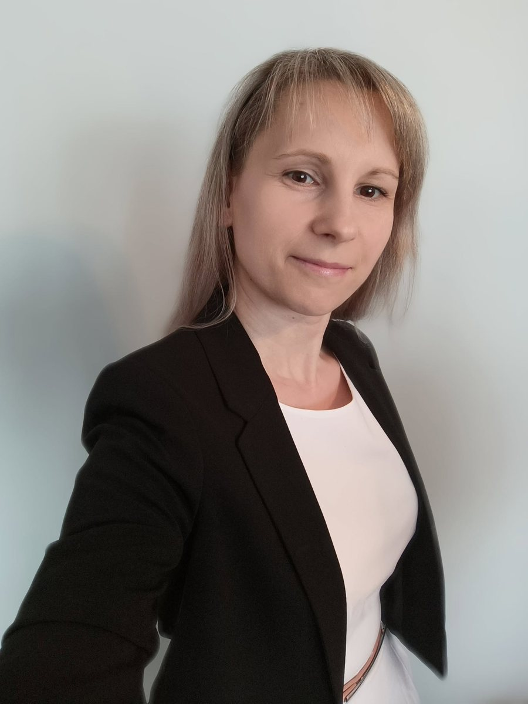

```{=html}
<div class="emi-profil">

<dl class="emi-profil-adatok">
<dt>Munkahely</dt>
<dd>Debreceni Egyetem, Pszichológiai Intézet<br>Szociál- és Munkapszichológiai Tanszék</dd>
<dt>Szerep a kutatócsoportban</dt>
<dd>vezető, kapcsolattartó</dd>
<dt>Munkacsoport</dt>
<dd>MI-attitűd és társas együttműködés</dd>
<dt>E-mail</dt>
<dd><a href="mailto:hujber-mitru.szilvia@arts.unideb.hu">hujber-mitru.szilvia@arts.unideb.hu</a></dd>
</dl>
</div>
```

# MI-attitűd és társas együttműködés munkacsoport

- MI-vel kapcsolatos attitűdök, bizalom és technológiaelfogadás, életkori különbségek
- MI-nek tulajdonított társas és szakmai szerepek: milyen feltételek mellett fogadjuk el támogatóként, társként, segítőként vagy munkatársként
- MI szerepe a pszichológiai segítségnyújtásban és a pszichoterápiában
- MI-használat és az emberi kapcsolatok, a társas támogatás és a segítségkérés összefüggései
- MI munkafolyamatokba történő beépítésének vizsgálata
- MI hatása a szakmai szerepekre, a szakmai identitásra és a munkahelyi jóllétre

# Önéletrajz

Pszichológusként a Debreceni Egyetem Pszichológiai Intézetének Szociál- és Munkapszichológiai Tanszékén dolgozom oktatóként. Kutatási érdeklődésem középpontjában a társas kapcsolatok és a digitális technológiák használatának pszichológiai vonatkozásai állnak. Munkámban egyre nagyobb szerepet kap a mesterséges intelligencia, amely kutatási témaként és az oktatásban alkalmazható eszközként egyaránt foglalkoztat. Fontosnak tartom, hogy használatát pszichológiai szempontból is értelmezzük, lehetőségeit és korlátait pedig tudatosan mérlegeljük.

Oktatói munkám részeként az Intézet MA-hallgatóinak Mesterséges intelligencia kurzust tartok, amelynek célja az MI pszichológiai vonatkozásainak megismerése és a tudatos, kritikus használat támogatása. A témával 2023 óta előadásokon és workshopokon is foglalkozom: előadtam az MTA Pszichológiai Munkabizottságának ülésén, valamint többalkalmas workshopot is tartottam a Debreceni Egyetem Bölcsészettudományi Karának munkatársai számára. Az MI pszichológiai, etikai és oktatási vonatkozásairól, valamint az általam vezetett, MI-hez kapcsolódó kutatások eredményeiről hazai és nemzetközi konferenciákon és interjúkban is beszámolok.

[← Vissza a kutatócsoport oldalára](../kutatocsoportrol.qmd)
