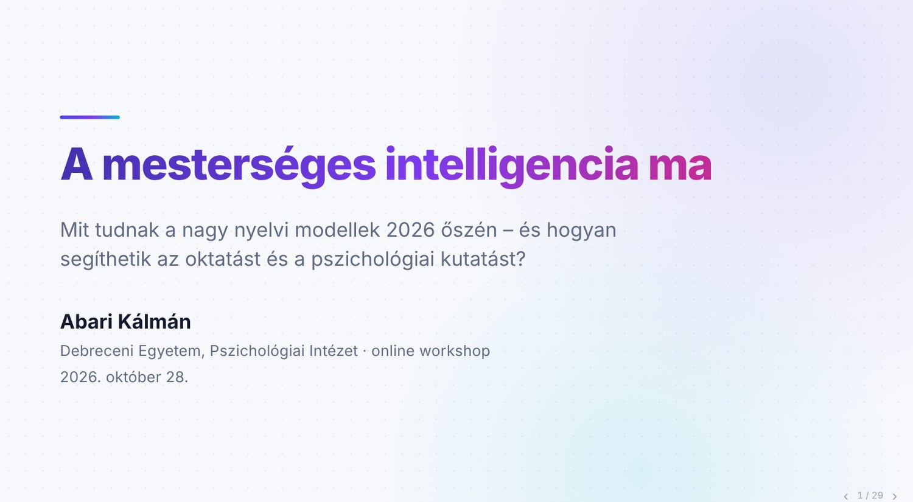

# A rendezvény adatai

::: emi-event-card

Rendezvény

: A mesterséges intelligencia ma – online workshop

Előadó

: Abari Kálmán (Ember–MI Kapcsolatok Kutatócsoport)

Szervező

: Debreceni Egyetem, Pszichológiai Intézet

Időpont

: 2026\. október 28., 12:00–13:00 (50 perc előadás, 10 perc kérdések)

Helyszín

: Online

Diasor

: [A mesterséges intelligencia ma – a workshop diasora](../lp_rovid_ismertetok/online_workshop_20261028_MI_I.html#/1)
:::

[{width="85%" fig-align="center"}](../lp_rovid_ismertetok/online_workshop_20261028_MI_I.html#/1)

# A workshop diasora

A diasor itt az oldalon is lapozható (nyilakkal vagy a diára kattintva), és külön lapon, teljes képernyőn is megnyitható.

::: {.emi-deck}
<iframe src="../lp_rovid_ismertetok/online_workshop_20261028_MI_I.html#/1" title="A mesterséges intelligencia ma – a workshop diasora" loading="lazy" allowfullscreen style="width:100%; aspect-ratio:16/9; border:1px solid rgba(127,127,127,.35); border-radius:8px;"></iframe>
:::

[Diasor megnyitása új lapon](../lp_rovid_ismertetok/online_workshop_20261028_MI_I.html#/1){.btn .btn-outline-primary target="_blank" rel="noopener"}

# Rövid beszámoló

A kutatócsoportból Abari Kálmán *A mesterséges intelligencia ma* címmel tartott online workshopot a Debreceni Egyetem Pszichológiai Intézetében. Az ötvenperces előadás, amelyet tízperces kérdés-felelet követett, azt járta körül, mire képesek a nagy nyelvi modellek 2026 őszén, és hogyan segíthetik az oktatást, valamint a pszichológiai kutatást.

A workshop hat témakört érintett:

1. **Hol tartunk?** – 2022 novemberétől máig a modellek három lépésben fejlődtek: megtanultak *kommunikálni*, *gondolkodni* (reasoning modellek) és *cselekedni* (ágensek). Az előadás bemutatta, hogyan állítja elő a nyelvi modell a szöveget, és miből erednek a korlátai: a hallucináció, a hízelgő igazodás (szikofancia), a kulturális torzítás és az adatvédelmi kockázatok.
2. **Mire jó nekünk?** – Az MI lehetőségei és kockázatai az oktatásban, oktatói és hallgatói oldalról, valamint a pszichológiai kutatás lépéseiben, a tervezéstől az írásig. Szóba kerültek a szabályozási keretek is: az EU MI-rendelete, a GDPR, valamint a Debreceni Egyetem és a BTK MI-irányelvei.
3. **Eszközök** – Chatbotok, ágensek, forrásalapú eszközök és MI-keresők: mikor melyiket érdemes választani.
4. **Tanulás** – A jó prompt elemei és ingyenes képzési lehetőségek oktatóknak.
5. **Copilot a DE-n** – Az egyetemi fiókkal ingyenesen elérhető, védett Microsoft Copilot Chat használata, és annak tisztázása, mit jelent és mit nem jelent a „védettség”.
6. **Példák** – Két teljes oktatói munkafolyamat: tesztkérdések készítése saját előadásból, valamint szakirodalmi összefoglaló készítése feltöltött cikkek alapján, mindkettő emberi ellenőrzéssel.

A diasor interaktív elemeket is tartalmaz – például idővonalat, eszköztérképet és promptépítő gyakorlatot –, így a workshop témái önállóan is áttekinthetők.

## Öt tanács az előadásból

- Kezdje kicsiben, saját feladaton: egy feladatsor, egy szakirodalmi összefoglaló, egy e-mail.
- Az egyetemi, védett Copilot Chatet használja – és mindig nézze meg a zöld pajzsot.
- Ellenőrizzen minden tényt, hivatkozást és számot – a felelősség az emberé.
- Tervezze meg a hallgatói használatot: olyan feladatot adjon, ahol az MI a tanulást segíti, nem helyettesíti.
- Tanuljon folyamatosan a szolgáltatók ingyenes képzéseiből és a kutatócsoport anyagaiból.

# Kapcsolódó anyagok

- [A mesterséges intelligencia ma – a workshop diasora](../lp_rovid_ismertetok/online_workshop_20261028_MI_I.html#/1)
- [Első lépések az MI világában – gyakorlati útmutató](../lp_rovid_ismertetok/rovid_elso_lepesek_20261004.qmd)
