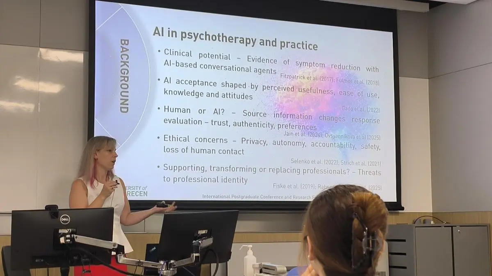

# A rendezvény adatai

::: emi-event-card

Rendezvény

: International Postgraduate Conference and Research Forum (IPCRF 2026)

Szervező

: The Education University of Hong Kong

Időpont

: 2026\. július 28–31.

Helyszín

: Hongkong

Előadó a kutatócsoportból

: Hujber-Mitru Szilvia

Előadás

: *Psychology in the Age of AI: Human Connection, Therapeutic Acceptance and the Future of Professional Practice*

Diasor

: [Az előadás diái letölthetők (PDF, 28 oldal, 5,5 MB)](fajlok/hujber-mitru_ipcrf2026_diasor.pdf){download="hujber-mitru_ipcrf2026_diasor.pdf"}

Beszámoló

: [A Pszichológiai Intézet hírében](https://pszichologia.unideb.hu/hirek/hongkongi-tudomanyos-forumon-mutatkoztak-be-pszichologiai-intezet-phd-hallgatoi)
:::

{width="85%" fig-align="center" fig-alt="Hujber-Mitru Szilvia előad egy teremben; a kivetítőn az AI in psychotherapy and practice című dia látható."}

# Rövid beszámoló

A hongkongi The Education University of Hong Kong által szervezett nemzetközi posztgraduális konferencián és kutatási fórumon (IPCRF 2026) több mint 400 résztvevő vett részt 30 országból és régióból. A rendezvény középpontjában a reziliencia, az alkalmazkodóképesség és a fenntartható fejlődés állt.

A Debreceni Egyetem Pszichológiai Intézetének doktoranduszai között a kutatócsoport egyik vezetője, **Hujber-Mitru Szilvia** is előadást tartott *Psychology in the Age of AI: Human Connection, Therapeutic Acceptance and the Future of Professional Practice* címmel. Az előadás három, magyar résztvevőkkel végzett kérdőíves vizsgálat eredményeit foglalta össze:

1. **Érzelmi kötődés a generatív MI-chatbotokhoz** – hogyan alakul ki kötődés a beszélgető MI-rendszerekhez, és ez hogyan kapcsolódik az antropomorfizációhoz, vagyis ahhoz, hogy emberi tulajdonságokat tulajdonítunk a gépnek.
2. **Az MI-alapú pszichoterápia elfogadása** – a segítséget keresők nyitottabbnak bizonyultak az MI-alapú terápiás megoldásokra, mint a mentálisegészség-szakemberek.
3. **Pszichológusok és pszichológushallgatók attitűdjei** – a hallgatók nagyobb szakmai fenyegetést érzékeltek az MI részéről, mint a gyakorló pszichológusok.

Az eredmények a kutatócsoport fő kérdéseihez kapcsolódnak: hogyan alakítja a mesterséges intelligencia az emberi kapcsolatokat, a segítő szakmák elfogadottságát és a pszichológusi hivatás jövőjét.

Az intézetet a konferencián Csontos Flóra doktorandusz is képviselte, aki a home office és a hibrid munkavégzés szervezeti állampolgári viselkedésre gyakorolt hatásáról szóló kutatását mutatta be.

# Forrás

- [Hongkongi tudományos fórumon mutatkoztak be a Pszichológiai Intézet PhD-hallgatói – DE Pszichológiai Intézet, 2026. október 29.](https://pszichologia.unideb.hu/hirek/hongkongi-tudomanyos-forumon-mutatkoztak-be-pszichologiai-intezet-phd-hallgatoi)
