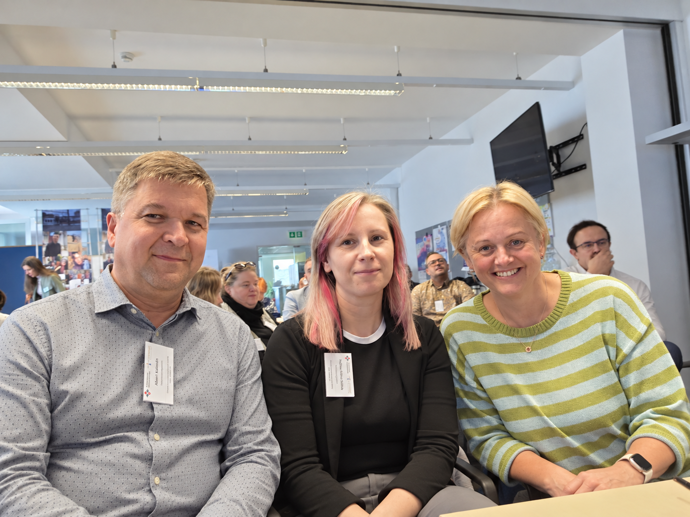

# A rendezvény adatai

::: {.emi-event-card}

Rendezvény
: Oktatói kompetenciafejlesztő műhely: mesterséges intelligencia és digitalizáció a nemzetközi képzésekben

Szervező
: Tempus Közalapítvány

Időpont
: 2026\. október 15., 9:30–15:00

Helyszín
: 1077 Budapest, Kéthly Anna tér 1.

Részvétel
: Szakmai műhely résztvevőjeként

Honlap
: [A rendezvény hivatalos oldala](https://tempus.idloom.events/oktatoi-kompetenciafejleszto-muhely-2026-oktober)

:::

{width="85%" fig-align="center"}

# Rövid beszámoló

Az Ember–MI Kutatócsoport képviselői részt vettek a Tempus Közalapítvány által szervezett szakmai műhelyen, amely a mesterséges intelligencia és a digitalizáció felsőoktatásban betöltött szerepével foglalkozott. A műhely középpontjában a mesterséges intelligencia felsőoktatási alkalmazásának pedagógiai, módszertani és etikai kérdései álltak.

A délelőtti előadások az MI oktatási értékelésre és akadémiai integritásra gyakorolt hatásával, a szakdolgozatírás új kihívásaival, valamint a szóbeli vizsgáztatás szerepével foglalkoztak.

**10:10–12:00 – MI, értékelés és akadémiai integritás**

- **Dr. habil. Horváth László** (ELTE PPK): Hogyan biztosítható a tanulás-tanítás minősége és integritása a mesterséges intelligencia korában? – Egy kari szintű komplex, önszabályozó pedagógiai keretrendszer bemutatása.
- **Dr. Arapovics Mária** (ELTE TáTK): A mesterséges intelligencia megjelenése a szakdolgozatírásban: tapasztalatok, bírálói kihívások és intézményi válaszok.
- **Dr. Barczi András** (MATE): Szóbeli vizsgák az egyensúlyért.
- Közös beszélgetés az előadásokról és a kapcsolódó témákról.

A délutáni program a mesterséges intelligenciával támogatott aktív tanulás, az oktatási célú játékfejlesztés, a virtuális tanulási asszisztensek, a digitális tanulástámogatás és a hallgatói motiváció lehetőségeit járta körül.

**12:45–14:00 – MI-alapú digitális tanulástámogatás és aktív tanulás**

- **Oroján Sándor** (NYE): Edukatív órai játékok fejlesztése AI segítségével.
- **Dr. Csóka László** (PTE): Kurzusra szabott mesterséges intelligencia alapú virtuális tanulási asszisztensek a hallgatói tanulás támogatására a felsőoktatásban.
- **Dr. Alpár Vera** (METU): Digitális tanulástámogató eszközök és innovatív megközelítések: tapasztalatok nemzetközi hallgatók interkulturális fejlesztésében a felsőoktatásban.

**Hallgatói motiváció és személyre szabott támogatás**

- **Erdész Fanni** (NJE): A hallgatói motiváció újjáélesztése és fenntartása.

**14:00–15:00 – Kérdések, tapasztalatmegosztás, zárás és összegzés**

# Résztvevői reflexiók és tapasztalatok

A szakmai műhelyen részt vevő kutatócsoporti tagok az alábbiakban osztják meg a rendezvényhez kapcsolódó benyomásaikat, a számukra legfontosabb gondolatokat és a kutatómunkájuk szempontjából hasznosítható tapasztalatokat.

## Abari Kálmán

A műhely előadásai megerősítették számomra, hogy a felsőoktatás az átalakulás és az útkeresés fázisában van az MI rendkívüli fejlődése miatt. Az elhangzott értékes előadások felvetették azokat a kérdéseket, amelyek szinte minden oktatóban és kutatóban felmerülnek, miután 2-3 hónapot eltöltöttek egy MI eszközök használatával. Az előadások tartalmaztak jó gyakorlatokat és részben válaszokat is, nagyon hasznosnak találtam őket. A tanulságokat röviden így foglaltam össze magam számára:

- az oktatók és hallgatók MI kompetenciáját növelni érdemes, kurzusokra, tudásmegosztó műhelyekre, jó gyakorlatok megosztására van szükség,
- a Karok/Intézmények MI használati szabályozását érdemes lenne egységesíteni, legalább a hasonló profilú képzőhelyek MI szabályozása lehetne hasonló,
- részletes útmutatót kellene kidolgozni az MI eszközök etikus használatára, amelyek tételesen felsorolják, hogy mely tevékenység milyen elbírálás alá esik,
- a műhelymunkák/szakdolgozatok értékelési szempontjait az MI-re vonatkozó részekkel érdemes kiegészíteni,
- oktatók és hallgatók biztonságos, védett MI használatát támogatni érdemes, 
- a játékosítás továbbra is fontos kutatási terület.

