# Az írást támogató eszközök

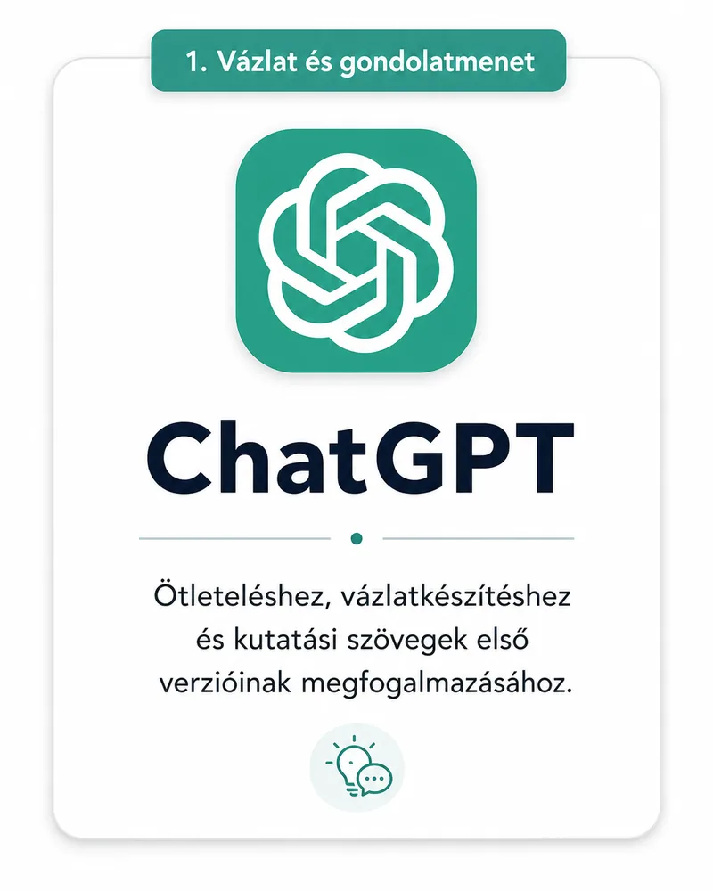{.lightbox width=20% group="my-gallery-01"}
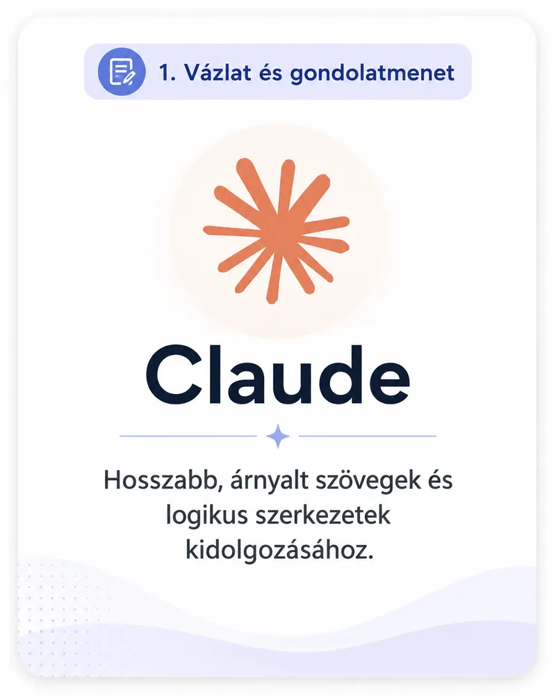{.lightbox width=20% group="my-gallery-01"}
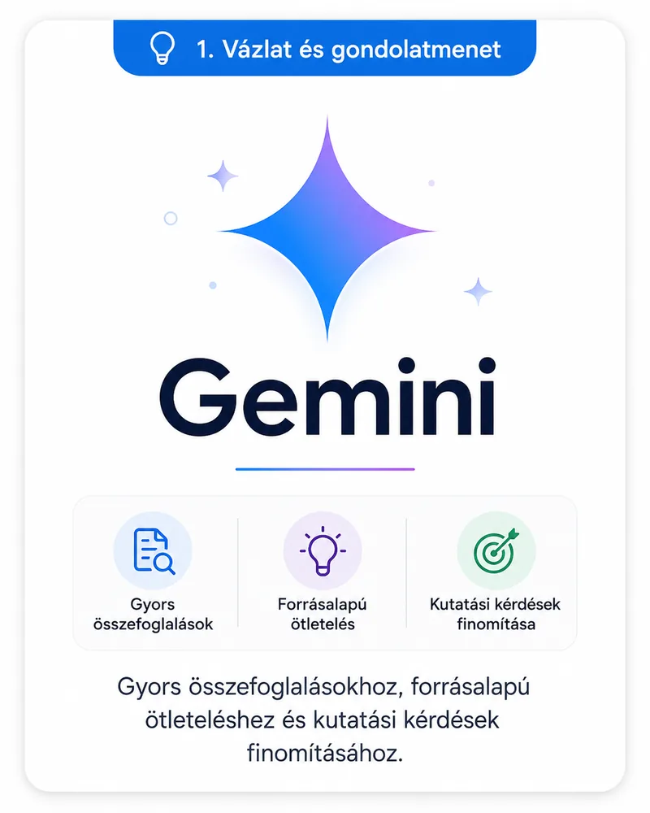{.lightbox width=20% group="my-gallery-01"}
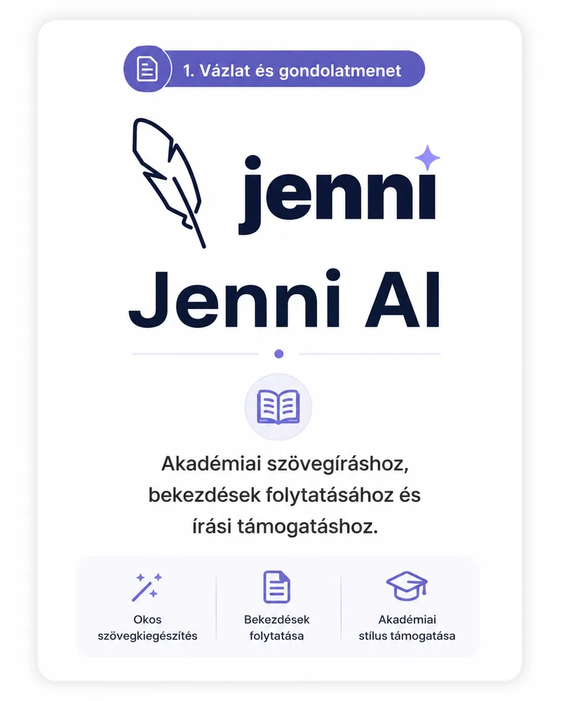{.lightbox width=20% group="my-gallery-01"}
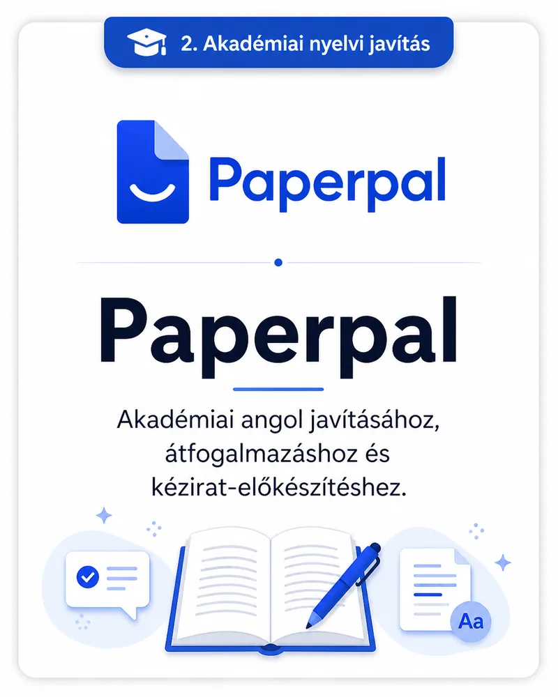{.lightbox width=20% group="my-gallery-01"}
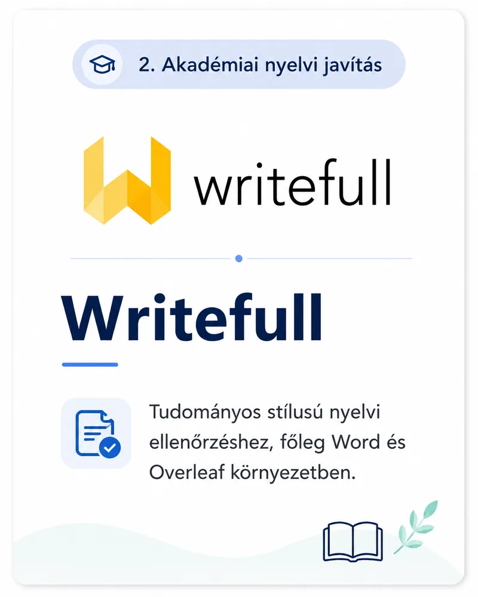{.lightbox width=20% group="my-gallery-01"}
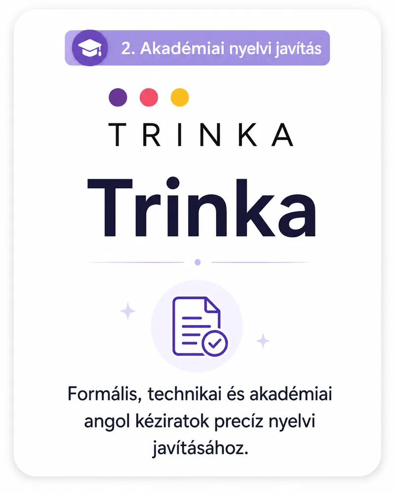{.lightbox width=20% group="my-gallery-01"}
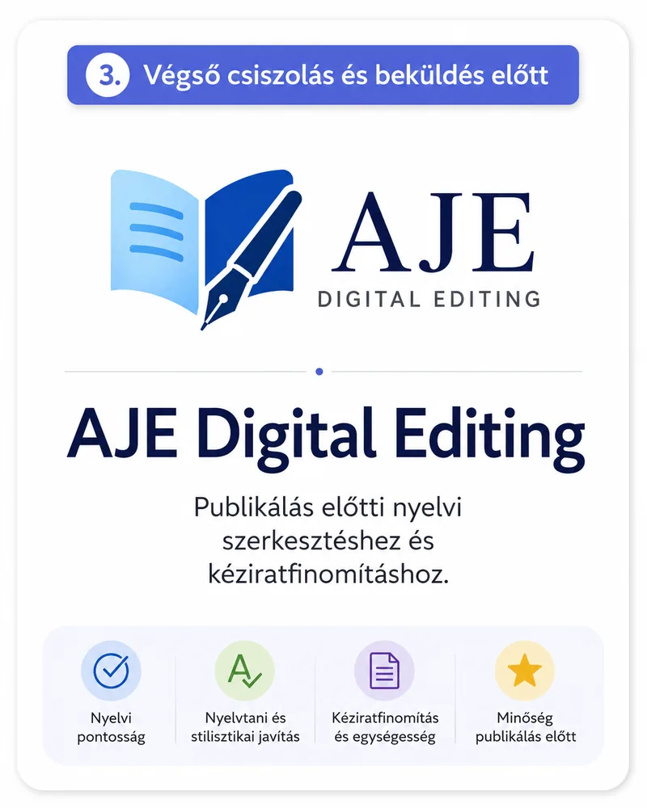{.lightbox width=20% group="my-gallery-01"}
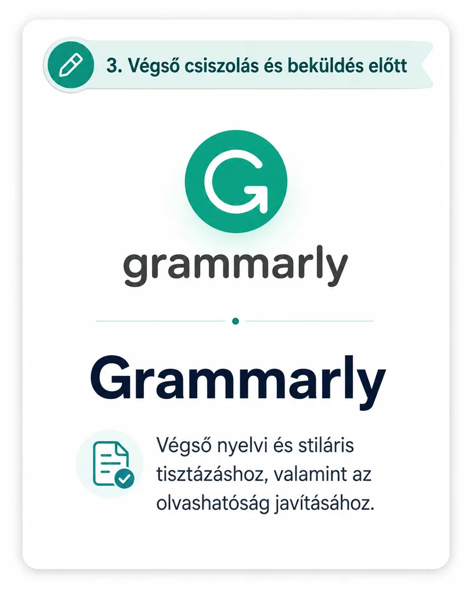{.lightbox width=20% group="my-gallery-01"}
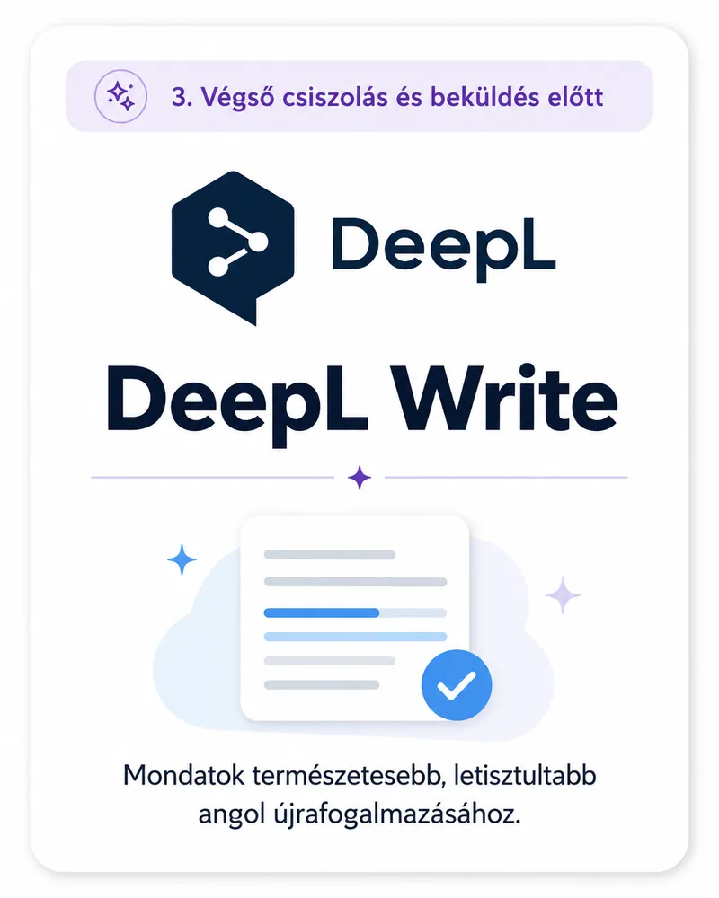{.lightbox width=20% group="my-gallery-01"}

# Az irodalomkeresést támogató eszközök

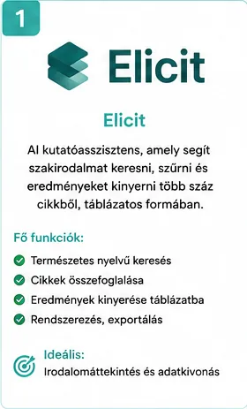{.lightbox width=20% group="my-gallery-02"}
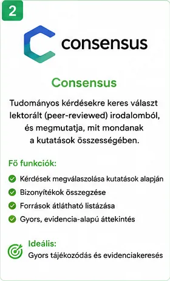{.lightbox width=20% group="my-gallery-02"}
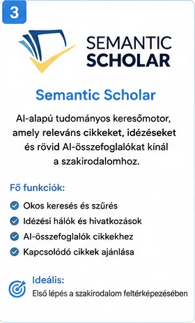{.lightbox width=20% group="my-gallery-02"}
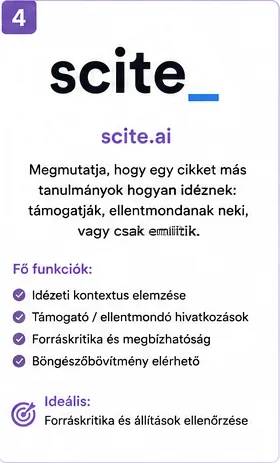{.lightbox width=20% group="my-gallery-02"}
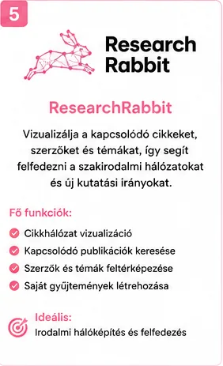{.lightbox width=20% group="my-gallery-02"}
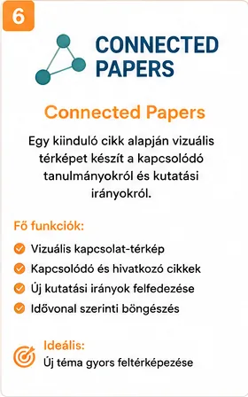{.lightbox width=20% group="my-gallery-02"}
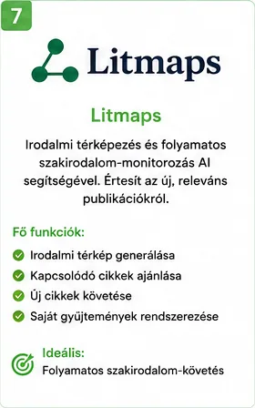{.lightbox width=20% group="my-gallery-02"}
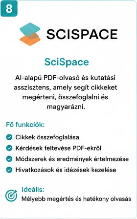{.lightbox width=20% group="my-gallery-02"}
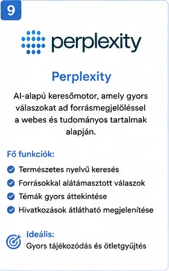{.lightbox width=20% group="my-gallery-02"}
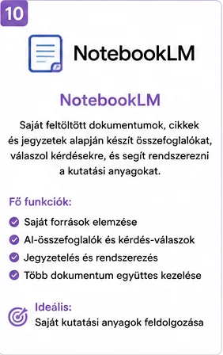{.lightbox width=20% group="my-gallery-02"}
